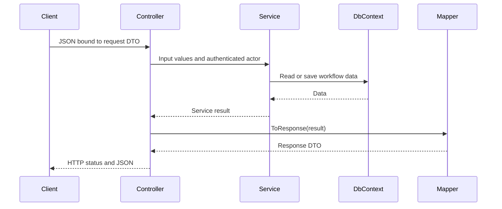

# Blue Harvest Pricing Exceptions

See the [current documentation index](docs/README.md) for the latest entity diagram, sequence diagrams, assumptions, presentation, and local Docker Word guide.

ASP.NET Core controller-based API targeting .NET 10 for creating, independently reviewing, and retrieving mortgage pricing exceptions. It runs locally without private infrastructure or paid services.

## Implementation

Models/Entities contains User, PricingExceptionRequest, RequestRevision, ReviewDecision, HistoryEntry, and IdempotencyRecord. Models/Enums contains RequestStatus, DecisionOutcome, and UserRole.

These plain C# models describe the class diagram. Data/PricingExceptionsDbContext exposes all six entities and maps their relationships, including the composite revision key. Startup uses PostgreSQL and applies the checked-in EF Core migrations. See [Docker and PostgreSQL commands](../../DOCKER.md) for setup, persistence, connection settings, and migrations.

PostgreSQL stores application data in the Compose postgres_data volume, which survives ordinary container restarts and removal. Isolated automated tests explicitly select InMemory; those stores remain temporary and do not enforce relational constraints.

Services and their interfaces are registered through dependency injection:

- PricingExceptionService creates requests, retrieves current terms, submits immutable revisions, approves or declines, and reads history, revisions, and decisions.
- ApprovedDiscountService returns a discount only when the current revision has an approval. It returns null when no current approval exists.
- UserService looks up internal users and enforces roles from stored user records.

Services validate input, ownership, self-review restrictions, expected versions, and revision numbers. Every mutation appends history and stores an idempotent result. Identical retries replay the original result; reuse of a key with different input raises ConflictException. Keys are scoped by caller, operation, and target request.

Current demo policies: one request per application, discounts of 1–500 basis points, reasons up to 2000 characters, and revisions allowed after a decision. A revision makes the request Pending and withdraws the previous effective approval. All known internal users can read requests and history. These policies remain assumptions to confirm.

InMemoryWriteLock retains its original name and coordinates service reads and writes within one application process. The history endpoint reads its collections under that lock. SaveChanges rejects edits or deletion of historical revisions, decisions, history, and completed retry records. PostgreSQL uses a transaction for each SaveChanges call, including state, history, and the retry record. The process lock does not coordinate multiple API instances; cross-instance workflow guarantees need additional database constraints and transaction design. The service owns changes within its DbContext scope; callers must not stage unrelated changes in that scope.

PostgreSQL replaces the earlier InMemory application storage and the SQLite proposal in the original design documents. Those historical design documents describe earlier implementation choices.

Observability/PricingExceptionsTelemetry exposes ActivitySource and Meter hooks named BlueHarvest.PricingExceptions, with mutation, replay, and conflict counters tagged only by operation type. No customer reasons or identifiers are added to telemetry tags. Exporters are not configured.

Controllers obtain actor IDs from authenticated claims. Development authentication accepts an X-User-Id header for one of the seeded demo identities below. This header is deliberately disabled outside Development; configure a trusted identity provider before running authenticated workflows in another environment. No production identity provider is configured yet. Mortgage application existence validation is pending; non-empty application IDs are accepted as external references for now.

## Test in Swagger

Creation captures the requester ID (the existing CreatedByUserId, also exposed as requesterId) and a requester-name snapshot from the authenticated user. Supply reviewerId from GET /api/v1/users/reviewers; the service stores the selected reviewer's ID and name. GET /api/v1/users/me returns the signed-in user's profile. The frontend uses these endpoints to show the read-only requester and reviewer dropdown.

Only the selected reviewer may approve or decline. Assignment remains unchanged across revisions. Responses distinguish assignedReviewerId/assignedReviewerName from reviewerId/reviewerName for the actual decision. Decision names and UTC timestamps are retained in history even if user display names later change.

Open http://localhost:5267/swagger, expand an operation and select Try it out. Supply X-User-Id using the appropriate seeded identity:

| Role | X-User-Id |
| --- | --- |
| RelationshipManager | 11111111-1111-1111-1111-111111111111 |
| Reviewer | 22222222-2222-2222-2222-222222222222 |
| MortgageProcess | 33333333-3333-3333-3333-333333333333 |

| Method | Route | Role |
| --- | --- | --- |
| POST | /api/v1/pricing-exceptions | RelationshipManager |
| GET | /api/v1/pricing-exceptions | Known internal user; all current requests |
| GET | /api/v1/pricing-exceptions/{id} | Known internal user |
| POST | /api/v1/pricing-exceptions/{id}/revisions | Owning RelationshipManager |
| POST | /api/v1/pricing-exceptions/{id}/decisions | Reviewer |
| GET | /api/v1/pricing-exceptions/{id}/history | Known internal user |
| GET | /api/v1/mortgage-applications/{id}/approved-discount | MortgageProcess |

1. Create as the manager with an Idempotency-Key such as create-001:

```json
{
  "mortgageApplicationId": "aaaaaaaa-aaaa-aaaa-aaaa-aaaaaaaaaaaa",
  "discountBps": 50,
  "reason": "Competitive rate offer",
  "reviewerId": "22222222-2222-2222-2222-222222222222"
}
```

2. Copy the returned request id. Submit a decision as the reviewer with a new key such as review-001:

```json
{
  "outcome": "Approved",
  "expectedVersion": 1,
  "reviewedRevisionNumber": 1,
  "reason": "Accepted"
}
```

3. Retrieve the approved discount using the mortgage application ID and the MortgageProcess identity.
4. Submit revised terms as the original manager using expectedVersion 2, expectedRevisionNumber 1, and a new idempotency key. The request becomes Pending; approved-discount lookup returns 404 until the new revision is approved. History retains the original terms and decision.

Every POST requires Idempotency-Key. Reuse a key only for an identical retry of the same operation. Create and revision return 201 with a Location header; reads and decisions return 200. Errors use Problem Details: 400 invalid input, 401 missing/invalid identity, 403 forbidden operation, 404 unknown request/no current approval, and 409 conflicting changes or retry payload. Enum values are strings such as Approved and Declined.

HTTP DTOs are separate from service results and persistence entities. The history response includes events, revision terms, and past decisions.

Response conversion is organized in the Mappings folder:

- PricingExceptionMapper converts a PricingExceptionResult into PricingExceptionResponseDto.
- ApprovedDiscountMapper converts an ApprovedDiscountResult into ApprovedDiscountResponseDto.
- HistoryMapper converts a history snapshot, including its events, revisions, and decisions, into HistoryResponseDto.

The request flow is: request DTO -> controller -> service -> DbContext. The service returns a result, the controller calls the corresponding mapper, and the response DTO is serialized to JSON. Request DTO properties currently become service method arguments directly. Mappers are static, explicit property mappings; business validation stays in the services.



## Service validation

```powershell
dotnet test BlueHarvest.PricingExceptions.slnx
```

The automated suite contains 24 unit cases and 45 HTTP integration cases. It covers approval, decline, revision and reapproval, preserved history, rejected historical edits/deletes, concurrent retries, decision-versus-revision conflicts, exact HTTP retry responses, validation, status codes, identity and role checks, Swagger, and disabled demo authentication outside Development. Each test host receives an isolated InMemory store. Tests do not validate relational guarantees.

The GitHub Actions workflow restores, builds and tests the backend with .NET 10. It has been added to the repository; successful remote execution must be verified after pushing.

With the Development API running, run the HTTP smoke checks from this directory:

```powershell
./tests/Invoke-ApiSmokeTests.ps1
```

This creates a fresh demo request and exercises the controller workflow, validation, role checks, error codes, and Swagger. It uses a new application ID and idempotency keys on every run.

## Run

From this directory:

```powershell
dotnet restore BlueHarvest.PricingExceptions.slnx
dotnet build BlueHarvest.PricingExceptions.slnx
dotnet run --project src/PricingExceptions.API --launch-profile http
```

Open http://localhost:5267/swagger in Development. Visual Studio launch profiles open Swagger automatically; terminal launches require opening the URL manually.

Stop the API before rebuilding if Windows reports a locked executable. PostgreSQL workflow data survives restart. Development startup adds any missing demo users without clearing existing records.

## Design references

See [Assumptions and scope decisions](docs/Architecture/Assumptions.md) for implemented business policies, PostgreSQL and demo-authentication trade-offs, and decisions requiring stakeholder confirmation.

The [Word assumptions document](docs/Assumptions.docx) is generated from the same Markdown source. To regenerate it from this directory:

```powershell
./tools/Export-AssumptionsDocument.ps1
```

See [submission notes](docs/Architecture/SubmissionNotes.md) for requirement coverage and production changes, and [AI development log](docs/Architecture/AiDevelopmentLog.md) for contribution and verification details. Actual developer time is not yet recorded and must be entered before submission.

Design documents are organized under docs/EntityClassDiagram, docs/SequenceDiagrams, and docs/Architecture.
