# Current entity relationship model

Derived from entities, DbContext mappings and the checked-in PostgreSQL migration.

The six entities shown are the current persisted model, not the original proposal. PostgreSQL table names are plural DbSet names. MortgageApplicationId is an external reference: no local MortgageApplication table or foreign key exists.

RequestRevision uses composite primary key (RequestId, RevisionNumber). ReviewDecision has its own Id primary key and a unique foreign-key pair (RequestId, RevisionNumber), giving a revision zero or one decision. HistoryEntry references both its request and its composite revision.

IdempotencyRecord.RequestId is nullable in the model and migration, although the workflow currently fills it. CurrentRevisionNumber is a service-managed pointer: there is no composite foreign key from PricingExceptionRequest to its current revision.

Version is an EF concurrency token; it is not a database-generated row version. One request per application and actor/scope/key retry uniqueness are checked by services: the current migration does not create unique indexes for either rule.

Submitted revisions, decisions, history and completed retry records are protected from edits/deletion through DbContext SaveChanges guards. The PostgreSQL migration defines cascade deletes for required FKs, and an optional retry-record FK without cascade; these are not database append-only triggers. Direct SQL can bypass application guards.

RequesterName, AssignedReviewerName and ReviewerName are stored name snapshots. Changing a current user profile does not rewrite historical attribution. Enums are stored as PostgreSQL integers; API JSON uses enum names.

The service sets ResponseStatusCode and ResponseJson on retry records, but does not populate nullable Location. The controller derives HTTP status and Location on each response. HistoryEntry.Details is nullable and the workflow does not currently set it.

## User / Users

| Property | C# type | Key |
| --- | --- | --- |
| Id | Guid | PK |
| DisplayName | string | — |
| Role | UserRole | — |

## PricingExceptionRequest / PricingExceptionRequests

| Property | C# type | Key |
| --- | --- | --- |
| Id | Guid | PK |
| MortgageApplicationId | Guid | — |
| CreatedByUserId | Guid | FK |
| RequesterName | string | — |
| AssignedReviewerId | Guid | FK |
| AssignedReviewerName | string | — |
| Status | RequestStatus | — |
| CurrentRevisionNumber | int | — |
| Version | long | — |
| CreatedAtUtc | DateTimeOffset | — |
| UpdatedAtUtc | DateTimeOffset | — |

## RequestRevision / RequestRevisions

| Property | C# type | Key |
| --- | --- | --- |
| RequestId | Guid | PK, FK |
| RevisionNumber | int | PK |
| DiscountBasisPoints | int | — |
| Reason | string | — |
| SubmittedByUserId | Guid | FK |
| SubmittedAtUtc | DateTimeOffset | — |

## ReviewDecision / ReviewDecisions

| Property | C# type | Key |
| --- | --- | --- |
| Id | Guid | PK |
| RequestId | Guid | FK |
| RevisionNumber | int | FK |
| Outcome | DecisionOutcome | — |
| ReviewReason | string? | — |
| ReviewedByUserId | Guid | FK |
| ReviewerName | string | — |
| DecidedAtUtc | DateTimeOffset | — |

## HistoryEntry / HistoryEntries

| Property | C# type | Key |
| --- | --- | --- |
| Id | Guid | PK |
| RequestId | Guid | FK |
| RevisionNumber | int | FK |
| Sequence | long | — |
| Action | string | — |
| ActorUserId | Guid | FK |
| Details | string? | — |
| OccurredAtUtc | DateTimeOffset | — |

## IdempotencyRecord / IdempotencyRecords

| Property | C# type | Key |
| --- | --- | --- |
| Id | Guid | PK |
| ActorUserId | Guid | FK |
| OperationScope | string | — |
| Key | string | — |
| PayloadHash | string | — |
| ResponseStatusCode | int | — |
| ResponseJson | string | — |
| Location | string? | — |
| RequestId | Guid? | FK |

