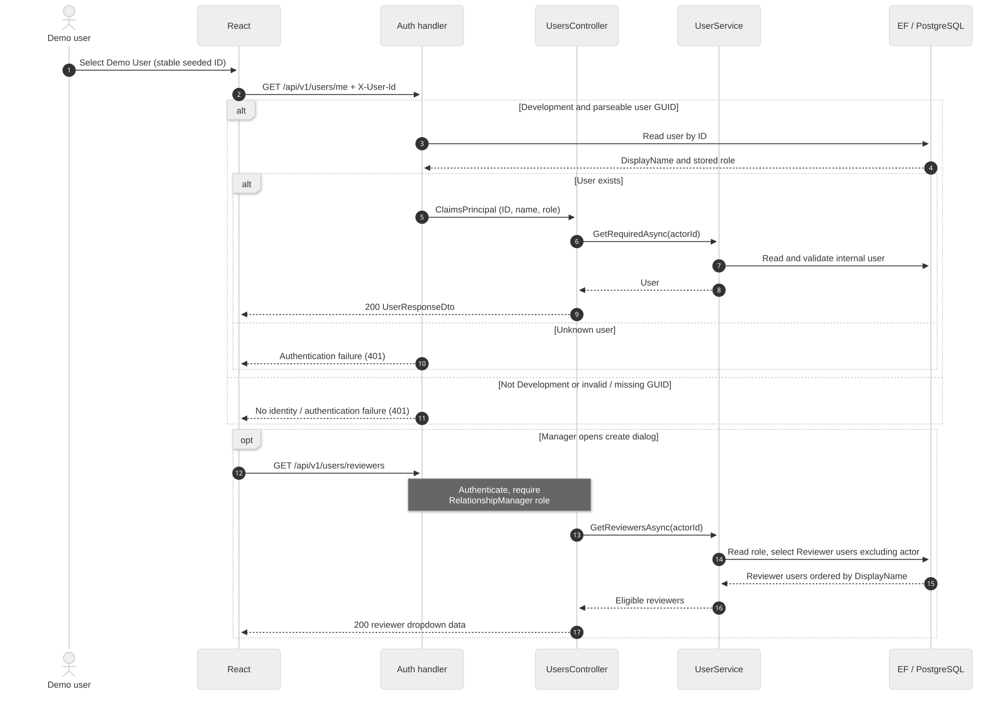
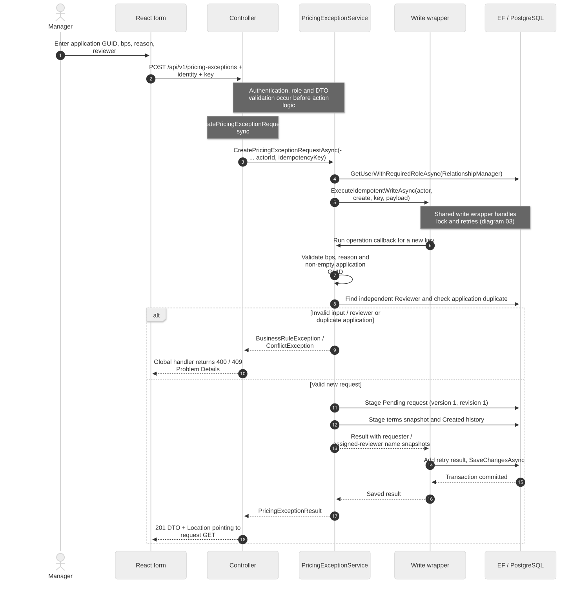
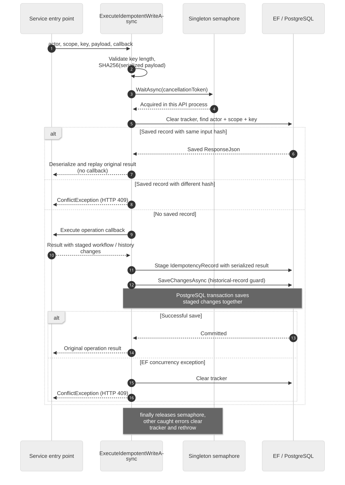
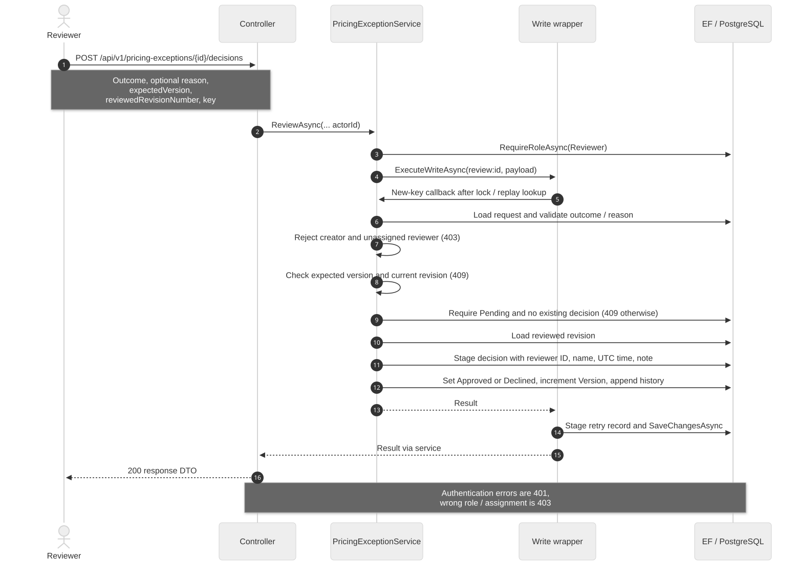
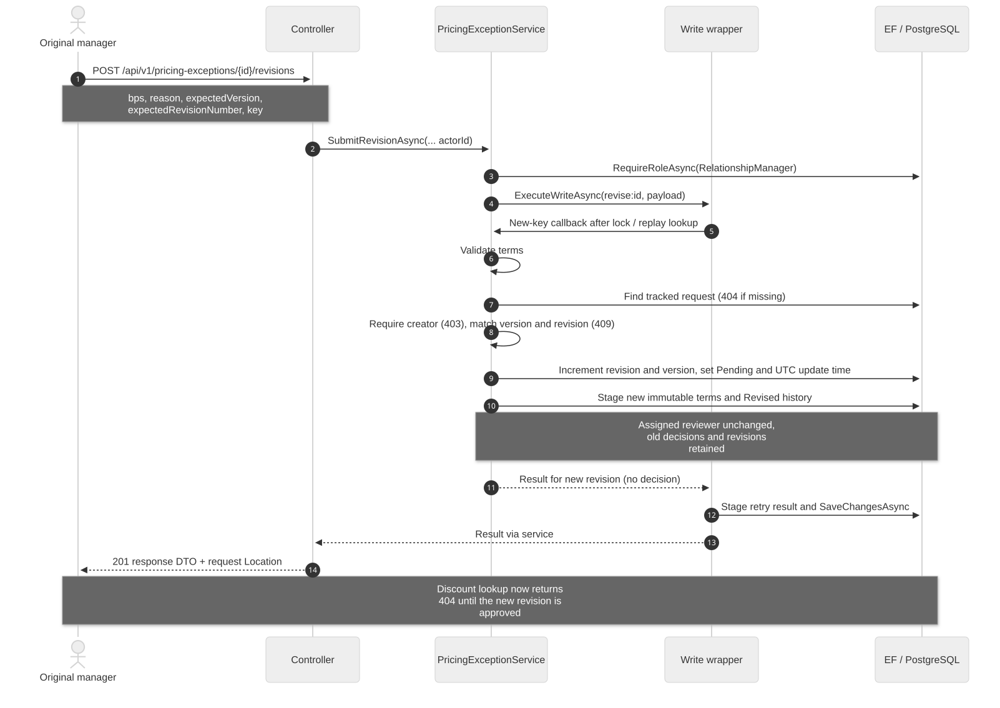
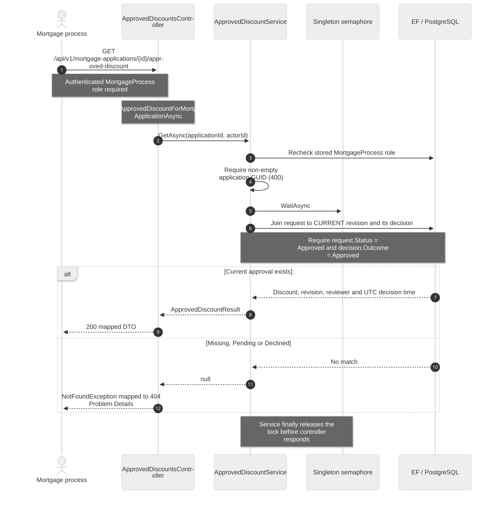
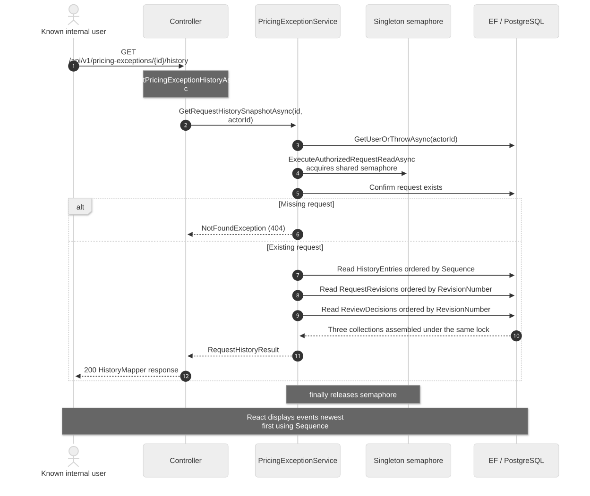
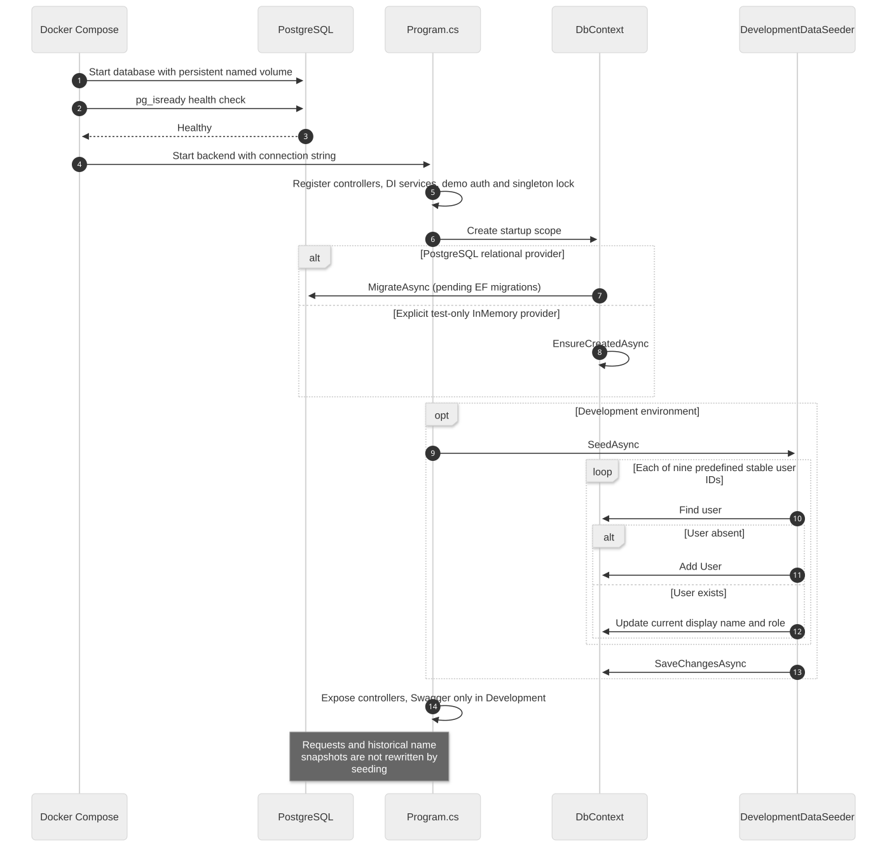

# Current sequence diagrams

PostgreSQL application implementation; explicit test-only InMemory path is noted in startup.

## Development identity and reviewer selection

The ID header supplies no trusted role: the handler reads the stored role. Invalid GUIDs and unknown users fail authentication. Outside Development the demo scheme returns no identity. The API rechecks stored roles in services. There are three managers, five reviewers and one Mortgage Process user; switching closes dialogs and refreshes actor-dependent reads.

Sources: DevelopmentAuthenticationHandler.cs; UsersController.cs; UserService.cs; Header.tsx; RequestFormDialog.tsx.

## Create a pricing exception request

Same-key replays bypass the operation callback. A different key for an existing mortgage application hits the service duplicate check. MortgageApplicationId is an external reference, not a foreign key to a local mortgage table. One request per application is a service policy, not a unique database index in the current migration.

Sources: PricingExceptionsController.CreatePricingExceptionRequestAsync; PricingExceptionService.CreateAsync, NewRevision, AppendHistory; ExecuteWriteAsync.

## Shared write execution and idempotent retries

Scopes are create, revise:{requestId}, and review:{requestId}. The actor is part of the lookup. The saved ResponseStatusCode is set to 200 for review and 201 otherwise, but controllers actually choose HTTP status and Location on each response. Location is a nullable entity property and is not populated by this wrapper. The semaphore serializes only one API process; actor/scope/key has no database unique index yet.

Sources: PricingExceptionService.ExecuteWriteAsync; PricingExceptionsDbContext.SaveChangesAsync / ProtectHistoricalRecords; InMemoryWriteLock.cs.

## Approve or decline the assigned revision

The current request must be Pending and match both expected values. Assignment is independent of who last edited or viewed a record. A unique (RequestId, RevisionNumber) index on ReviewDecisions additionally enforces at most one decision per revision in PostgreSQL. The decision record has no direct foreign key to PricingExceptionRequest; it references RequestRevision.

Sources: PricingExceptionsController.RecordPricingExceptionDecisionAsync; PricingExceptionService.ReviewAsync; ReviewDecision entity; UserService.GetUserWithRequiredRoleAsync.

## Revise terms and withdraw effective approval

Revision is allowed while Pending and after either decision. Even unchanged terms create a new revision. No old approval is deleted; it becomes historical because current revision and status change. Version increases on both revision and decision; revision number increases only when terms are submitted.

Sources: PricingExceptionsController.SubmitPricingExceptionRevisionAsync; PricingExceptionService.SubmitRevisionAsync, CheckVersion, NewRevision; ApprovedDiscountService.GetAsync.

## Retrieve the effective approved discount

Only the current revision participates. Historical approvals never substitute for Pending revised terms. This endpoint reads exception state; it neither fetches a mortgage application nor consumes an approval. An approval has no implemented expiry or external revocation contract.

Sources: ApprovedDiscountsController.GetApprovedDiscountForMortgageApplicationAsync; ApprovedDiscountService.GetAsync; ApprovedDiscountMapper.cs.

## Read a consistent request history snapshot

Any known internal user may read history under current policy. The lock coordinates only writes in this process; the reads are not wrapped in a database snapshot transaction, so do not claim a cross-instance atomic snapshot. History uses request Version as Sequence. AsNoTracking reads avoid modifying submitted records.

Sources: PricingExceptionsController.GetPricingExceptionHistoryAsync; PricingExceptionService.GetHistorySnapshotAsync / ReadRequestAsync; HistoryMapper.cs; HistoryTimeline.tsx.

## Startup, PostgreSQL migrations and idempotent seeding

The application defaults to PostgreSQL. Only an explicit Database:Provider=InMemory selects temporary test storage. Compose starts the frontend after the backend container starts, but does not currently wait for backend HTTP readiness. PostgreSQL migrations occur before the API serves requests. No additional production authentication is implied by this startup flow.

Sources: compose.yaml; Program.cs; DevelopmentDataSeeder.cs; Data/Migrations.

