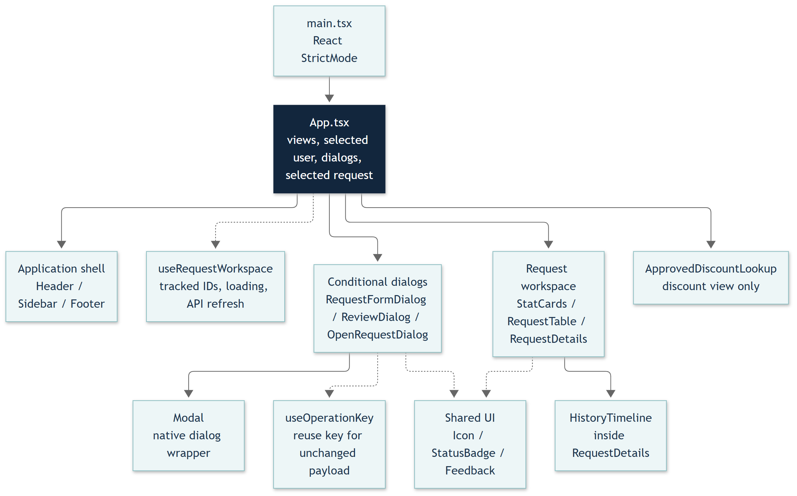
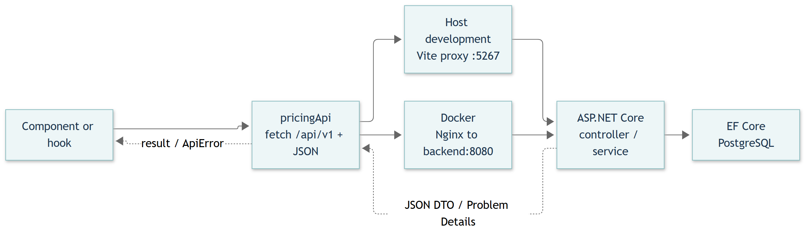

# Frontend design — Blue Harvest

Code-based developer handoff, 6 November 2026. React and TypeScript provide the internal pricing-exception workspace. Vite supports development and builds; Nginx serves the compiled frontend in Docker. This document describes the current implementation, not a proposed redesign.

## 1. Component diagram

Solid arrows show ownership/rendering groups; dashed arrows show hook or shared-UI dependencies. Groups condense related components, not additional React components. App switches three views using local state: requests, request history, and approved discounts. There is no client-side router or Redux store.

Code: src/main.tsx, src/App.tsx, src/components, src/hooks. All paths in this document are relative to FrontEnd unless stated otherwise.

<!-- pagebreak -->

## 2. Component responsibilities

| Component / file | Responsibility |
| --- | --- |
| App.tsx | Owns selected persona, view, request ID, active dialog, mobile menu, toast and action errors; coordinates successful operations. |
| Header.tsx | Shows connectivity, selected user's name and role; emits demo-user and menu changes. |
| Sidebar.tsx | Navigates views and shows pending count for tracked requests; closes mobile navigation after selection. |
| Footer.tsx | Product/developer credits, telephone/email links and GitHub repository link. |
| RequestSummary.tsx | Summarises the requests tracked in this browser workspace, rather than all database records. |
| PricingExceptionTable.tsx | Filters tracked requests by status/search and emits selection or Open request actions. |
| RequestDetails.tsx | Shows current terms, assignment, decision details and role-appropriate actions; loads history for the current request/user. |
| RequestHistory.tsx | Shows events newest first, with revision badges, actor/time, submitted terms or decision reasons. |
| RequestFormDialog.tsx | Handles create/revision inputs, validation and submission; fetches requester/reviewer data for creation. Assignment is retained during revision. |
| ReviewRequestDialog.tsx | Collects approval/decline and review note; submits expected version and revision. |
| RequestDetailsDialog.tsx | Loads the backend request directory, lets users select a request, then opens its current details in the workspace. |
| ApprovedDiscountLookup.tsx | Mortgage Process lookup of the current effective discount; opens the related request on demand. |
| Modal.tsx | Shared native HTML dialog: showModal, title/description, close, Escape/backdrop handling, and busy-state dismissal protection. |
| Shared UI | Icon.tsx contains SVG icons; StatusBadge.tsx renders statuses; Feedback.tsx supplies error alerts and empty states. |

Components receive data and callbacks through typed props. They do not access the database. Frontend visibility rules improve usability; backend role, assignment, version, and workflow checks remain authoritative.

<!-- pagebreak -->

## 3. Data flow

Example: RequestFormDialog calls pricingApi.create; fetch sends a POST to /api/v1/pricing-exceptions. Vite or Nginx proxies the call to ASP.NET Core. The backend returns JSON; App.success remembers the result, selects it, closes the dialog and shows a toast. Error responses become ApiError messages and leave the form available for correction or retry.

api/pricingExceptions.ts supplies relative API URLs, JSON handling and error conversion. Development/demo calls include X-User-Id; writes include Idempotency-Key. useOperationKey reuses a key while the payload is unchanged within the mounted dialog; it does not persist keys across reloads or dialog remounts. Create/revise/review payloads exclude trusted actor identity. The server enforces identity and business rules.

## 4. State management

| Owner | State and behaviour |
| --- | --- |
| App | Persona, view, selectedId, dialog, menuOpen, toast and actionError. Selected request is derived from workspace data. |
| useRequestWorkspace | Tracks up to 100 request IDs; fetches fresh records; exposes requests, loading, connected, error, refresh and remember. |
| Browser localStorage | blueharvest.requestIds stores references only, not reasons/decisions. Shared across demo users in that browser; not a complete database directory. |
| PricingExceptionTable | Local search text and status filter; filtering does not request new backend data. |
| RequestDetails | Details/history tab and history response keyed to the current request object and actor. |
| Forms and lookup | Inputs, busy/error states, directory data and lookup result. Lookup remounts on persona change. |

User switching changes the actor, closes dialogs and clears toast/action errors. Hooks refetch tracked requests and history, hide stale actor data, and use cancellation/generation checks to reject obsolete responses. API/database records remain the source of truth; opening a request adds its reference to the browser workspace.

<!-- pagebreak -->

## 5. Responsive behaviour

index.css sets base typography, focus states and a 360px minimum body width. App.css defines the workspace, tables, forms, modals and timeline; chrome.css supplies the shell and footer styling. App imports App.css before chrome.css, so later overrides matter.

| Screen / component | Current behaviour |
| --- | --- |
| Desktop workspace | Sidebar and top bar frame the page; request table and details share a grid while space permits. |
| Intermediate widths | Breakpoints at 1250/1050px adjust layout; footer wraps at 1100px. Inspect the specific CSS rule before changing sizing. |
| At 760px and below | Sidebar slides off-screen; menu button, scrim and Escape handling support navigation. Closed mobile sidebar is inert. Page actions and forms adapt to the narrower view. |
| Tables and modals | Table-scroll contains the wide table. Native dialog width is limited to viewport minus 32px and height to viewport minus 40px. |
| Small screens | Timeline spacing/type adjusts at 480px. Footer links stack at 420px; contact links wrap long text. |

Accessibility uses native buttons, labelled controls, dialog title/description references, aria-current navigation, aria-pressed filters, role=alert errors, status announcements and visible keyboard focus. These are implemented features, not a claim of a complete accessibility audit.

## Developer extension and validation notes

- Shared contracts: src/types/index.ts. Formatting, demo persona IDs and feature flag: src/lib/format.ts. Keep predefined IDs aligned with backend seed data.
- Demo switching is enabled by Vite DEV or VITE_ENABLE_DEMO_USERS=true. Normal production builds omit the picker and demo header; production authentication remains future work. Compose explicitly enables the local demo build.
- Connectivity currently probes /openapi/v1.json, which is Development-only. The indicator is not a general production readiness check.
- Keep API changes in src/api/pricingExceptions.ts; preserve cancellation, error handling, idempotency and expected-version semantics when adding forms.
- Verify with npm.cmd run build and npm.cmd run lint. Existing tests/workspace.spec.ts covers forms, retry failures, stale reviews, history, user switching, multi-reviewer flow and mobile layout. Previously recorded browser result: 13 passed; not rerun to generate this document.
- Vite proxy: vite.config.ts. Docker proxy: nginx.conf. Deploy source changes with docker compose up --build -d from the repository root.

The document was reviewed against current source. It does not change frontend behaviour or delete any repository files. Editable diagram sources are Components.mmd and DataFlow.mmd alongside this Markdown file.
